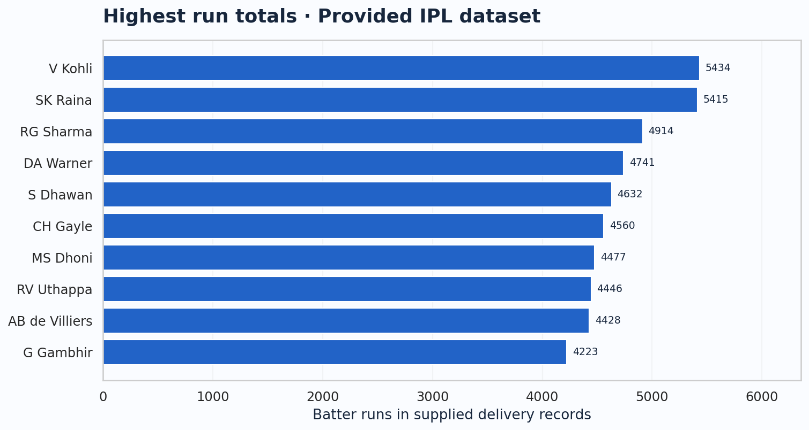
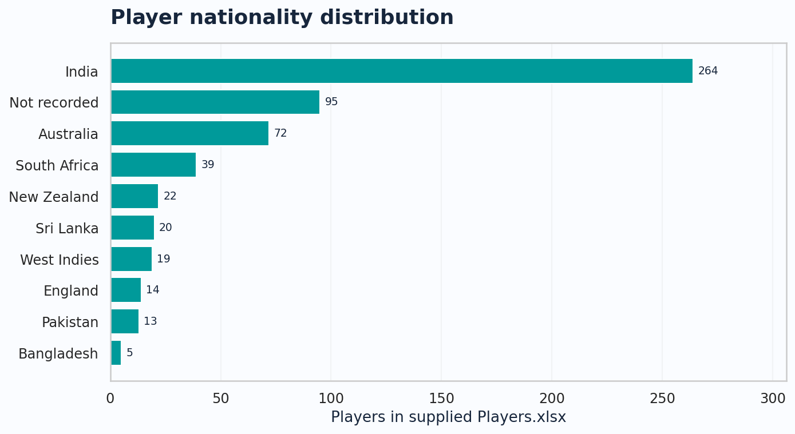
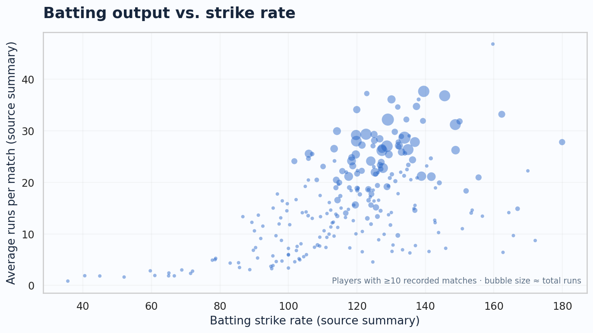
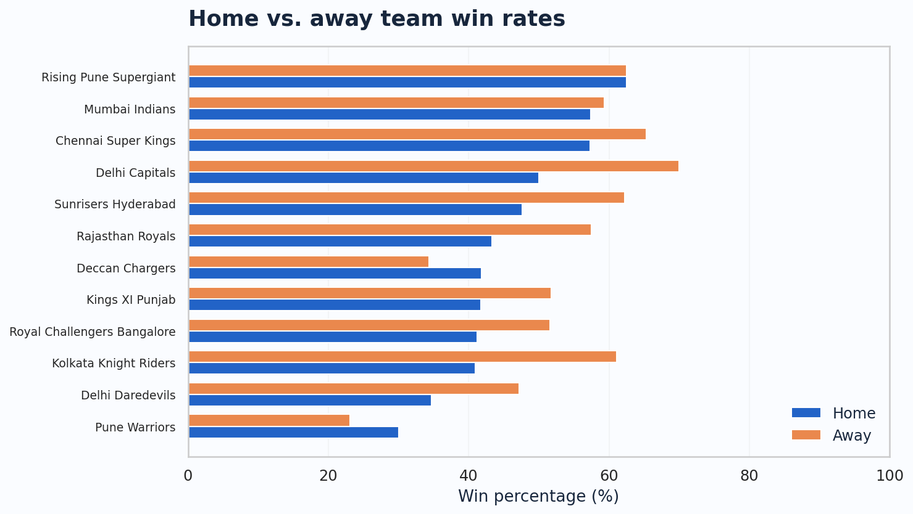
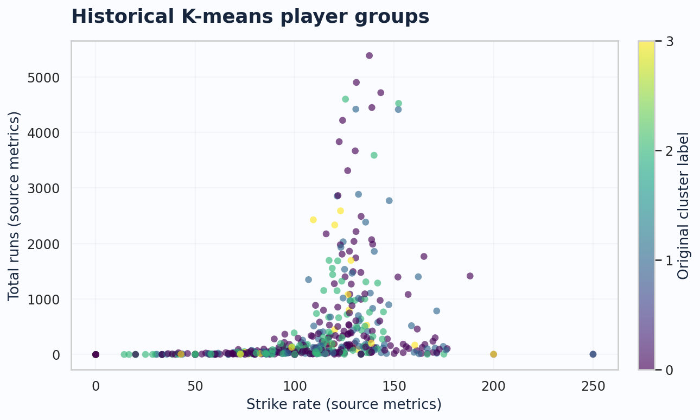

# Indian Premier League (IPL) — Player Analytics & Visualization

**Python · Pandas · Exploratory Data Analysis · Matplotlib · Seaborn · Player Segmentation**

An academic **team project** examining Indian Premier League cricket player demographics, batting performance, historical player groupings, and home-versus-away team results. This GitHub edition packages the available project data, retains the original group analysis in an archive, and adds a **portable, reproducible visualization script**.

> **Team project / contribution:** Developed as part of a KEDGE Business School group assignment by Andre Kurniawan, Cong Yao, Gowri Khotakota, Lakshmi Mahesh Sahu, and Naveen Koppolu. **Andre's assigned responsibilities were data visualization, conclusions and insights, team performance (home vs. away), and player performance and consistency analysis**, as documented in the group presentation. Other components are credited to the group rather than presented as individual work.

## At a glance

| Source file | Observations | Main purpose |
| --- | ---: | --- |
| `deliveries.csv` | **179,078** | Ball-by-ball IPL match events |
| `Players.xlsx` | **566** | Player demographics (DOB, country, batting/bowling attributes) |
| `Player_Consistency_Stats.csv` | **516** | Historical batting metrics |
| `Players_with_clusters.csv` | **516** | Player metrics with previously generated cluster labels |
| `teamwise_home_and_away.csv` | **14** | Supplied home/away team summary |

These are counts **in the available uploaded data**, not estimates of all IPL records. The group presentation cites a [Kaggle IPL dataset](https://www.kaggle.com/datasets/ramjidoolla/ipl-data-set) as a source; exact dataset release, matching provenance, and redistribution permissions have **not** been independently verified.

## Research questions

- How are IPL players distributed across countries and playing styles?
- Which batters accumulated the most runs in the available ball-by-ball records?
- How do historical scoring averages and strike rates relate?
- What do the team project’s player clusters reveal about historical performance profiles?
- How do provided home and away team win percentages compare?

## Selected visualizations

**Top batters by historical runs**



**Player nationality distribution**



**Average runs and strike rate**



**Home vs. away win percentages**



**Previously calculated player clusters**



> Charts above were regenerated from the supplied CSV/XLSX files for this portfolio edition. They are **not screenshots of the team's original presentation**, and represent descriptive historical analysis rather than verified forward predictions.

## Methods & tools

- **Data preparation:** Data inspection, type conversion, aggregation, and handling missing values.
- **Player analytics:** Totals by batter, demographics, comparative historical rates.
- **Segmentation:** Visualization of supplied K-means cluster assignments (the original group project also includes an exploratory clustering script).
- **Team analytics:** Comparison of precomputed home/away win percentages.
- **Historical group work:** Exploratory correlation analysis, dashboards, and a Random Forest performance-model experiment appear in the original materials under `archive/`. See [Limitations](#limitations-and-transparency).

## Run the reproducible figures

Requires Python 3.10+.

```bash
python -m venv .venv
# Windows PowerShell:
.venv\Scripts\Activate.ps1
# macOS / Linux:
# source .venv/bin/activate
pip install -r requirements.txt
python src/ipl_analysis.py
```

The script regenerates charts in `figures/` and writes `figures/summary_metrics.json`.

### Repository structure

```text
ipl-player-analytics/
├── README.md
├── requirements.txt
├── .gitignore
├── data/                      # Supplied historical datasets
│   ├── deliveries.csv
│   ├── Players.xlsx
│   ├── Player_Consistency_Stats.csv
│   ├── Players_with_clusters.csv
│   ├── teamwise_home_and_away.csv
│   └── teams.csv
├── figures/                   # Regenerated project charts
├── notebooks/                 # Guided reproducible notebook
├── src/
│   └── ipl_analysis.py
├── archive/                    # Original group project code
│   ├── notebooks/
│   └── scripts/
└── docs/
    ├── DATA_NOTES.md
    ├── ORIGINAL_PROJECT_NOTES.md
    └── IPL_Group_Project_Presentation.pdf
```

## Key findings in the supplied records

- `deliveries.csv` has **179,078 ball-by-ball records**, spanning **756 unique match IDs** and **516 distinct listed batters**.
- In these records, **V Kohli** has the highest total batsman runs (**5,434**). This ranking reflects the scope of these records, not an up-to-date IPL ranking.
- The project datasets support comparisons of player nationalities, batting metrics, existing cluster groups, and team home/away summaries.

## Limitations and transparency

1. **Historical dataset:** This repository is not current-season IPL reporting.
2. **Original missing inputs:** `matches.csv` and `most_runs_average_strikerate.csv` are referenced by multiple original scripts, but were **not provided**. Those original scripts and notebooks may not run unchanged.
3. **Original hard-coded paths:** Scripts in `archive/` preserve their original absolute Windows/macOS file paths; use `src/ipl_analysis.py` for the reproducible analysis.
4. **Predictive modeling:** An original Random Forest model uses historical cumulative metrics. It should **not** be interpreted as a validated forecast for a player's next match. The new charts do not assert any predictive accuracy.
5. **Cluster interpretation:** Existing cluster assignments are visualized as supplied; the labels are not independently validated as distinct player types or selection recommendations.
6. **Data provenance:** Original download URLs/licenses were not included in the uploaded project files. Verify source permissions before public redistribution.

## Original group presentation

The original 28-page team presentation is available at [`docs/IPL_Group_Project_Presentation.pdf`](docs/IPL_Group_Project_Presentation.pdf). It documents the project objectives, group responsibilities, analysis charts, and team conclusions. Please confirm your teammates' agreement and any publication requirements before making the repository public.

## Source materials and acknowledgments

This portfolio repository documents a collaborative university project. The `archive/` folder contains original group scripts and notebooks for transparency. Contributions from all team members are acknowledged above. Charts, formatting, and the portable analysis script in this GitHub edition are a later documentation/refactoring effort, not evidence that every original analysis was individually authored or production-ready.

---

**Maintained as a portfolio project by [Andre Kurniawan](https://github.com/andremeku)** · [LinkedIn](https://www.linkedin.com/in/drekurniawan)
